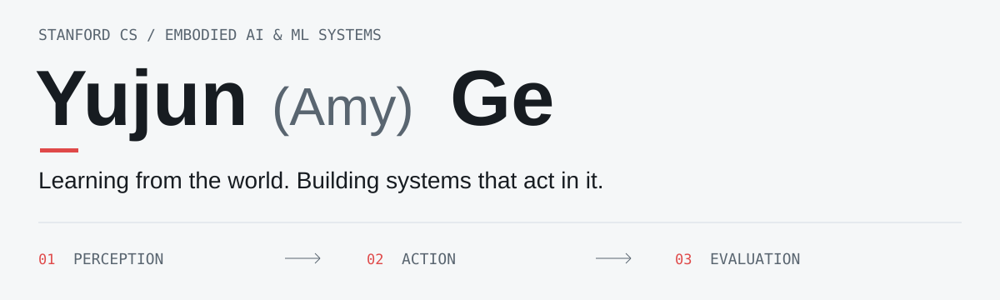
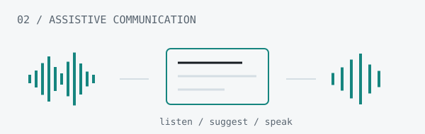
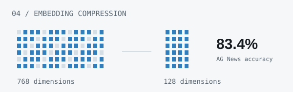
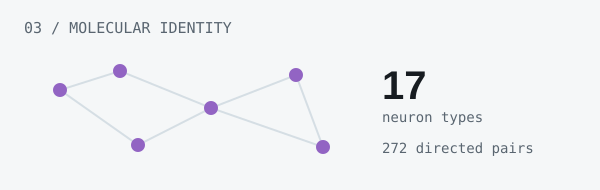
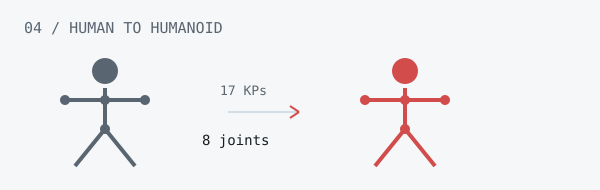

<picture>
  <source media="(prefers-color-scheme: dark)" srcset="./assets/header-dark.svg">
  <source media="(prefers-color-scheme: light)" srcset="./assets/header-light.svg">
  
</picture>

  
  
  

**Stanford CS · Research Assistant at ILIAD Lab / SAIL**  
Incoming **Amazon Software Development Engineer Intern**, Summer 2027

I build **AI that helps people communicate, learns from complex data, and turns research into useful software**. My work spans language and speech, accessibility, computer vision, computational neuroscience, and intelligent agents. I like moving between disciplines and following a question from the first experiment to a working system.

### What I bring

**Research curiosity** across language representations, biological signals, and learning systems. **Product thinking** through assistive communication and user-facing software. **Engineering depth** in agents, evaluation, and simulation.

### Right now

**ILIAD Lab / SAIL** &nbsp; Multimodal learning and generalization across platforms, environments, and tasks.  
**Common Origin** &nbsp; Founding AI engineer working on world models, simulation interfaces, and repeatable agent experiments.

Previously: dexterous manipulation at <b>AtomBite</b> · browser agents at <b>Kairos UGC</b> · anomaly detection at <b>Haurlan</b>

---

## Selected work

<table>
<tr>
<td width="50%" valign="top">
<a href="https://github.com/YujunGe07/V1_AI_ML_AAC">
<picture>
<source media="(prefers-color-scheme: dark)" srcset="./assets/aac-dark.svg">

</picture>
</a>
<h3><a href="https://github.com/YujunGe07/V1_AI_ML_AAC">Assistive Communication</a></h3>

An AAC prototype combining speech recognition, context-aware text suggestions, and speech output for people with speech or motor impairments.

<code>Whisper</code> <code>DistilGPT2</code> <code>Flask</code>

Speech and text input, TTS, and interaction history.

</td>
<td width="50%" valign="top">
<a href="https://github.com/YujunGe07/bert-embedding-compression">
<picture>
<source media="(prefers-color-scheme: dark)" srcset="./assets/bert-dark.svg">

</picture>
</a>
<h3><a href="https://github.com/YujunGe07/bert-embedding-compression">Smaller Embeddings</a></h3>

Studying how much of a BERT representation we can keep, and whether compression learned on one distribution transfers to another.

<code>Transformers</code> <code>PCA</code> <code>PyTorch</code>

Initial run: 83.4% at 128 dimensions vs. 83.0% at 768. Strict-split and category-shift experiments included.

</td>
</tr>
<tr>
<td width="50%" valign="top">
<a href="https://github.com/YujunGe07/common-origin-techical-challenge">
<picture>
<source media="(prefers-color-scheme: dark)" srcset="./assets/wiring-dark.svg">

</picture>
</a>
<h3><a href="https://github.com/YujunGe07/common-origin-techical-challenge">Molecular Identity to Wiring</a></h3>

Can gene expression help predict neural connectivity? A public-data pipeline with explicit baselines and held-out tests across Drosophila neuron types.

<code>Neuroscience</code> <code>Ridge regression</code>

17 neuron types. 272 directed pairs. Results and limitations included.

</td>
<td width="50%" valign="top">
<a href="https://github.com/YujunGe07/human-to-humanoid-motion">
<picture>
<source media="(prefers-color-scheme: dark)" srcset="./assets/robotics-dark.svg">

</picture>
</a>
<h3><a href="https://github.com/YujunGe07/human-to-humanoid-motion">Human to Humanoid Motion</a></h3>

Camera keypoints become constrained robot joint states. YOLO pose estimation, an eight-joint URDF, and ROS 2 / RViz visualization with a desktop preview.

<code>YOLO</code> <code>OpenCV</code> <code>ROS 2</code>

Geometry and URDF contract checks run in CI.

</td>
</tr>
</table>

**Also on the court:** [AI-Driven Tennis Coaching](https://github.com/YujunGe07/AI-Driven-Tennis-Coaching) uses ViViT embeddings and nearest-neighbor retrieval to compare tennis strokes with professional examples. Includes the research paper and analysis of camera angle, clip duration, and court appearance.

More to explore: <a href="https://github.com/YujunGe07/ECG-Signal-Analysis">ECG signal analysis</a> · <a href="https://github.com/YujunGe07/haurlan-lite">Prediction-market matching engine</a>

## Research & recognition

| Recognition | |
| :--- | :--- |
| **Regeneron STS** | Science Talent Search Scholar |
| **MIT URTC 2025** | Independent author of an IEEE publication; 4th Place Best Paper Award |
| **IEEE publication** | First author of research on AI-driven tennis coaching |

<b>Tools I build with</b>

 

| Area | Toolkit |
| --- | --- |
| Learning & perception | Python, PyTorch, TensorFlow, Hugging Face, scikit-learn, multimodal models, computer vision |
| Robotics & simulation | MuJoCo, CARLA, Unreal Engine, FlyBody, ManiSkill3, SAPIEN, LeRobot, ROS 2, URDF, FK/IK |
| Agents & systems | Playwright, Docker, tool orchestration, automated evaluation, structured logging, TCP/JSON |
| Applications & data | Java, JavaScript, TypeScript, SQL, Flask, PostgreSQL, Elasticsearch, Git, CI/CD |

---

<b>Different questions. A shared instinct to build.</b> Helping someone communicate. Understanding a signal. Testing an idea. I am interested in what AI can make possible across all of them.

<a href="mailto:yujunge@stanford.edu">yujunge@stanford.edu</a> &nbsp; / &nbsp; <a href="https://www.linkedin.com/in/yujun-ge/">LinkedIn</a>

